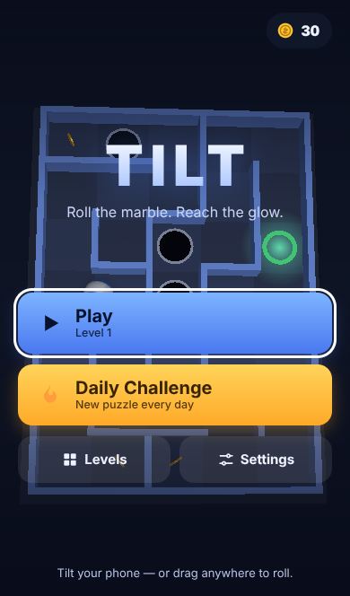
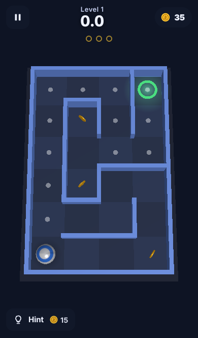
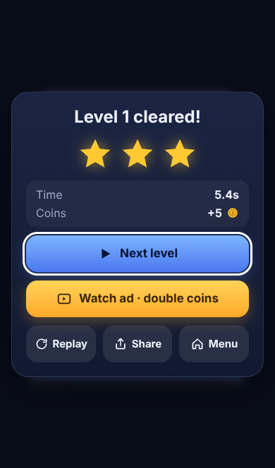

# Tilt — 3D marble maze for mobile & web

**Tilt your phone, roll the marble, reach the glow.** Infinite procedurally generated mazes, a Daily
Challenge with streaks, holes / ice / sticky floors, coins and hints — all in a ~145 KB (gzip) PWA that
works offline. Built with three.js, a tiny custom physics solver and zero runtime dependencies beyond that.

| Menu | Play | Win |
|---|---|---|
|  |  |  |

## Run it
```bash
npm install
npm run dev          # builds (dev, sourcemaps) and serves dist/ on http://localhost:8080
# or
npm run build && npm run serve
```
Open it on a phone (same network, or any HTTPS static host — **device-motion requires HTTPS**, `localhost` also counts).

## Controls
| Device | Control |
|---|---|
| Phone / tablet | **Tilt** the device (motion sensor). iOS asks permission the first time you press Play. Press the ◎ button to recalibrate "flat". |
| Any touchscreen | **Drag anywhere** — a virtual stick appears under your finger |
| Desktop | Arrow keys / WASD, or drag with the mouse. `Esc`/`P` pause, `R` recalibrate |

## Game rules in 30 seconds
* Reach the glowing ring. Stars come from time vs. par; each fall adds 2 s.
* **Holes** drop you back to the start. **Ice** (stripes) is slippery, **sticky** (dots) is slow.
* 3 coins per level; clear rewards + pickups buy **hints** (15) and **skips** (40). Free players always progress.
* **Daily Challenge**: same maze for everyone each day; keep your streak.
* No banner ads. Rewarded video is optional; the shipped provider is a labelled **demo** (see ADR-005).

## Scripts
| Command | What |
|---|---|
| `npm test` | 31 unit tests (generation, physics, autopilot solvability, save, economy, ads, perf) |
| `npm run build` | Production bundle → `dist/` (+ service worker, hashed assets) |
| `npm run sim` | Difficulty calibration sims (human-like controllers, first-time explorer) — re-run after tuning |
| `npm run e2e` | 24 browser tests against the production build (needs `playwright` + Chromium). `-- --shots` regenerates `docs/screenshots` |
| `npm run icons` | Re-render PNG icons from `public/icons/icon.svg` |
| `npm run check` | test + build |
| `TILT_ADS=off npm run build` | Build with **no ads at all** (recommended until a real ad provider is integrated) |

Debug URLs: `?level=N` jump to a level · `?auto` autopilot plays · `?q=low` force low graphics · `?debug` exposes `window.__tilt` and logs telemetry events.

## Project map
```
src/core   pure logic (rng, maze, levels, physics, autopilot, scoring, economy, save) — no DOM, fully tested in Node
src/game   renderer (three.js), input, run loop, audio synth, ads policy, perf governor, app shell
src/ui     DOM overlays + CSS
public/    html, manifest, service worker template, icons
docs/      PRD, game design, tech design, ADRs, roadmap, test plan, launch checklist, dev log
```

## Docs
[PRD](docs/PRD.md) · [Game design & tuning](docs/GAME_DESIGN.md) · [Tech design](docs/TECH_DESIGN.md) ·
[Decisions (ADRs)](docs/DECISIONS.md) · [Roadmap & status](docs/ROADMAP.md) · [Test plan](docs/TEST_PLAN.md) ·
[Launch checklist](docs/LAUNCH_CHECKLIST.md) · [Dev log](docs/DEVLOG.md) · [Changelog](CHANGELOG.md)

## Deploying
`dist/` is a static site with only relative URLs, so it works at a domain root or a sub-path. Any static host
over HTTPS works (GitHub Pages, Netlify, Cloudflare Pages, S3+CDN). Serve `sw.js` with `Cache-Control: no-cache`.
